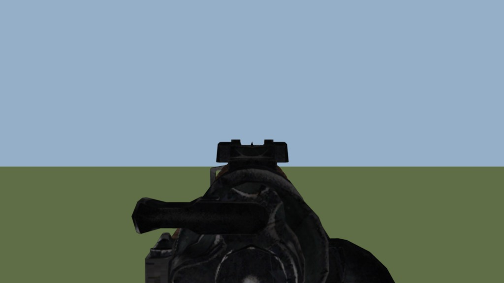

# Iron Sights for Sniper Elite 4

Takes the telescopic sights off the scoped rifles and lets you aim over open sights instead.

When you aim, the scope view is replaced by an iron-sight picture. Each picture is rendered from that
rifle's own in-game 3D model and textures, so it matches the rifle you hold.

- **15 rifles:** Carcano, Mosin-Nagant, Kar98k, Springfield M1903, Lee-Enfield No.4, Mannlicher M1895, Gewehr 43,
  Swedish Mauser, Winchester 1895, M1 Garand, SVT-38, Ross Mk III, De Lisle, ZH-29, M1 Carbine.
- **61 pictures:** one for every paint each rifle has (standard, woodland camo, winter, urban, night, gold), with
  metal shading on the gold rifles.
- **Aim point:** the tip of the front sight is exactly at the screen centre, where the bullet goes.
- **Sights the models lacked:** where a model has no usable open sight under its scope, a fitting one is built in:
  - Springfield M1903A4 and M1 Carbine: no open sights at all.
  - Ross, SVT-38 and De Lisle: front posts too coarse or too low to see.
  - ZH-29: front sight placed off the bore axis.

Works with DirectX 12 and DirectX 11: the mod edits the game data, it does not hook the renderer.



All 61 sight pictures: [docs/images/all_61_sights.png](docs/images/all_61_sights.png)

## Download

From the [Releases](../../releases) page:

- `IronSights_SE4_v1.0.0_exe.zip`: run `IronSights.exe`, no Python needed.
- `IronSights_SE4_v1.0.0_python.zip`: the same installer as a script, needs Python 3.8+.

The repository holds the script version (*Code → Download ZIP* works too).

## How it works

- Scope models are hidden (their triangles are collapsed). The M1 Carbine's scope is cut out of the rifle model.
- The scope view's reticles, tube shadow and lens ring are hidden. The lens distortion and blur masks are blanked.
- One full-screen element of the scope view shows the open-sight picture.

The game has one scope view for all rifles, so it can show only one picture at a time. The installer asks which
rifle and paint you will play with. Run it again to switch.

The zoom level stays as the scope had it.

## Requirements

- Sniper Elite 4, Steam version, with the DLC rifles you want to use.
- [Python 3.8 or newer](https://www.python.org/downloads/). Only the standard library is used. When installing
  Python, tick "Add python.exe to PATH".
- About 150 MB free disk space for the restore data.

## Install

1. Close the game.
2. Unpack this archive anywhere, for example to your desktop. It does not need to be in the game folder.
3. Run `Install.bat`. It finds the game through Steam. Choose **1 - install / change rifle**, then the rifle and
   its paint.

To switch rifle or paint, run `Install.bat` again.

If the game is not found, put the path of your `Sniper Elite 4` folder into `game_path.txt` next to
`IronSights.py`, or run:

```
python IronSights.py --game "D:\SteamLibrary\steamapps\common\Sniper Elite 4"
```

Command line: `python IronSights.py install kar98k body`, `python IronSights.py uninstall`,
`python IronSights.py status`. Rifle keys: carcano, mosin_nagant, kar98k, springfield_m1903, lee_enfield,
mannlicher, g43, swedish_mauser, winchester_1895, m1_garand, svt38, ross_mkiii, delisle_carbine, zh-29, m1_carbine.
Paint keys: body, camo, snow, urban, night, gold.

## Uninstall

Run `Uninstall.bat`.

The installer keeps the original compressed blocks it replaced in `IronSights_backup` inside the game folder.
Uninstall puts them back and checks that every file is byte-identical to what it was before. Steam's
**Verify integrity of game files** also undoes the mod.

## Notes

- Touches 41 archives: `Misc\Common.asr`, `GUIMenu\InGame_Common.gui` and the rifle DLC archives in `DLCData`.
  Other mods that change the same files may conflict. Uninstall this mod before installing or removing those.
- After a game update, uninstall first. If a file changed since install, the uninstaller leaves it alone and
  tells you.
- With a rifle other than the chosen one you still aim through the chosen rifle's picture.
- Single player. Not tested in online modes.

## Credits

- Model and archive formats: own research.
- Help from [Battlezone_Gold_Extractor](https://github.com/GrizzlyOne95/Battlezone_Gold_Extractor) by
  GrizzlyOne95 (MIT), a reader for Rebellion's Asura engine formats. Its code is not included here.
- Sniper Elite 4 and its assets © Rebellion. The sight pictures are rendered from the game's own models and
  textures and are distributed only as a modification for owners of the game.

## License

The installer code is under the MIT license (see `LICENSE.txt`).
